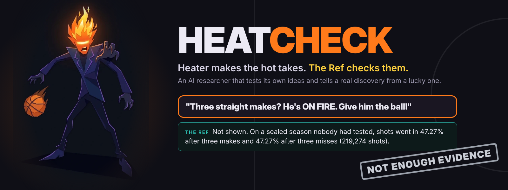
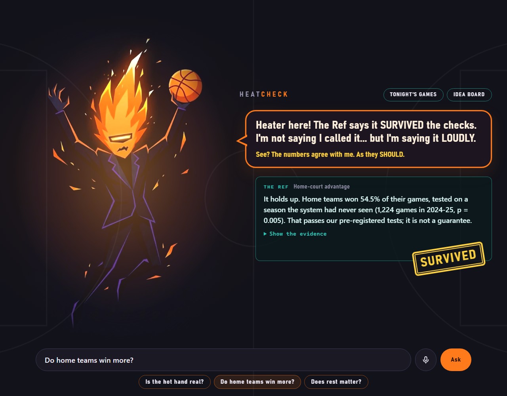
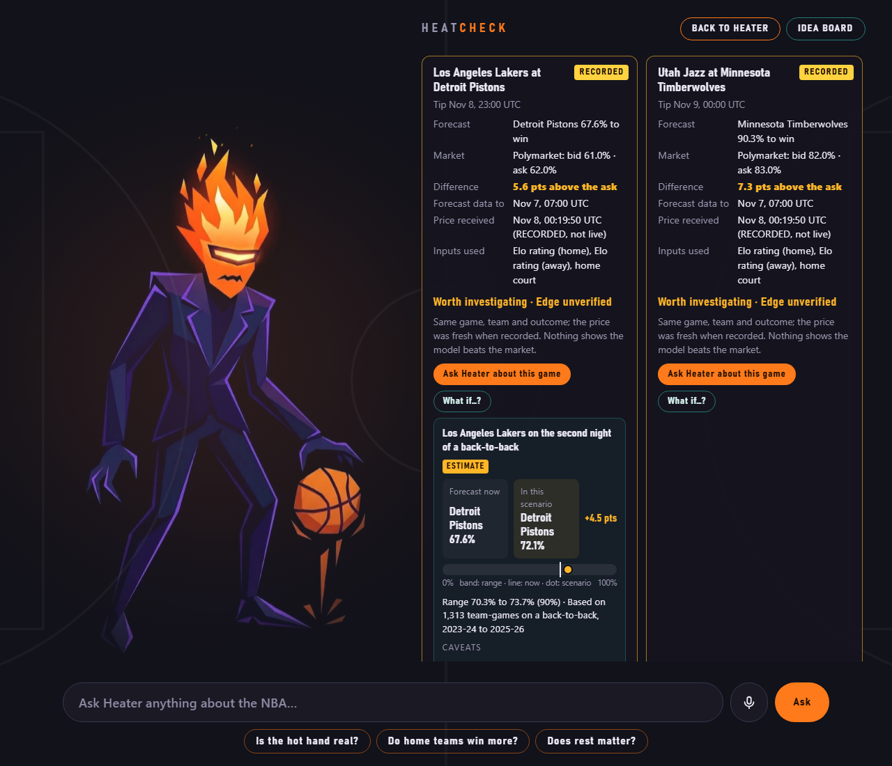
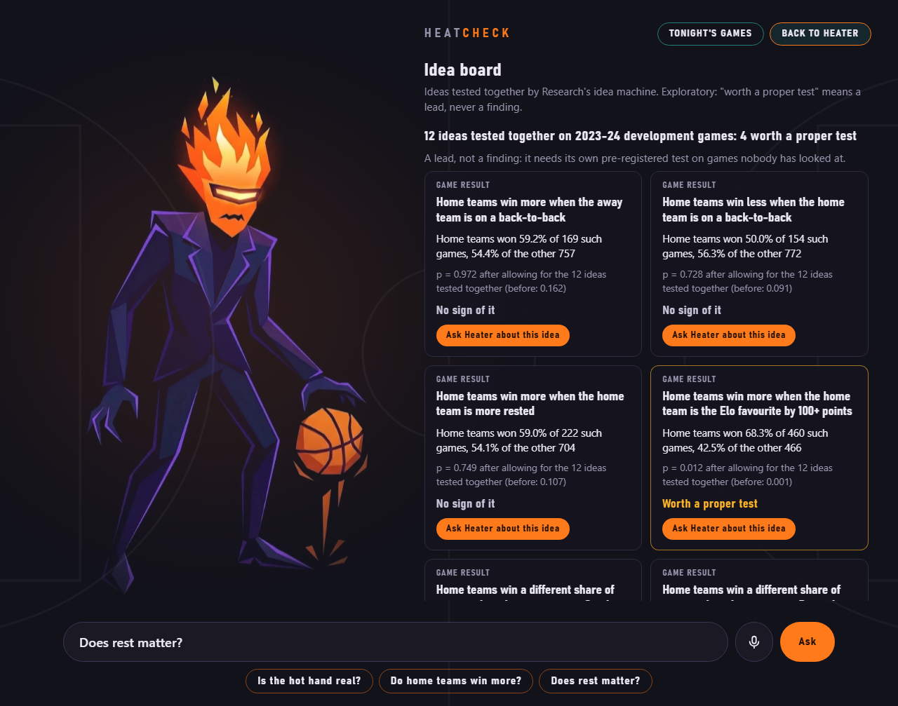
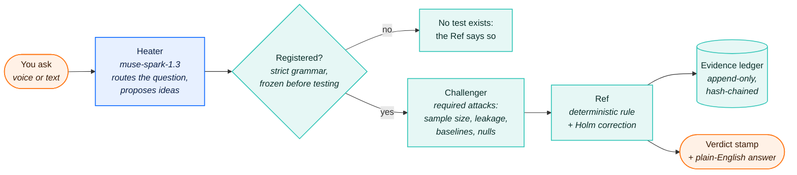
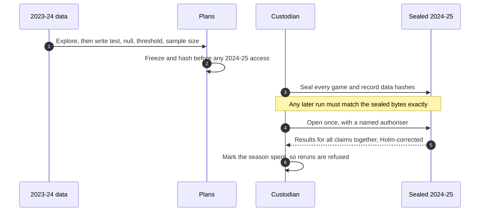

<div align="center">



# HeatCheck

An AI researcher for NBA data that proposes its own ideas,<br/>
locks them in before looking, tests them against fresh data<br/>
and tells you which ones are real and which ones were luck.


[](https://github.com/chisom-OOO/heatcheck-ai/actions/workflows/checks.yml)

[Results](#headline-results) · [How it works](#how-it-works) · [Try it](#run-the-demo) · [Evidence](#evidence-and-review) · [Write-up](docs/SUBMISSION.md) · [Limits](#disclosures-and-limits)

</div>

---

> **The brief:** *Finding patterns in data is easy; knowing which ones to trust is hard. Create an AI researcher that tests its own ideas and can tell a real discovery from a lucky one.*

HeatCheck splits that job between two characters. **Heater** is a loud, AI-voiced pundit who proposes ideas and hot takes. **The Ref** is plain code: it applies tests that were registered before the data was opened, and nothing Heater says can change a verdict. Every decision goes into an append-only, hash-chained evidence ledger.

## Headline results

**Sealed confirmatory test.** The whole 2024-25 regular season was sealed before any claim touched it. Three hypotheses were pre-registered on 2023-24 development data, then the sealed season was opened **once**, on the user's written authorisation, by a session that wrote none of the code. Before the run the custodian ledger held zero reservations on that season.

| Claim | 2024-25 result | Holm p | Verdict |
| --- | --- | --- | --- |
| Home teams win more often | 54.5% of 1,224 games; excess over 50% between +1.6 and +7.5 points (95%) | 0.0054 | **SURVIVED** |
| Momentum: a make makes the next make likelier | 46.7% after a make vs 47.1% after a miss | 1.0 | Not enough evidence |
| Hot hand: three makes in a row | 47.27% after three makes vs 47.27% after three misses (219,274 shots) | 1.0 | Not enough evidence |

"Not enough evidence" rather than "disproved", because no test for a zero effect was pre-registered: the protocol refuses to claim more than it tested. Receipt `5cbb3222`, result file sha256 `d1624599…` ([run report](reports/review/2026-11-07-2232-confirmatory-run.md)).

**2023-24 final split** (300 games, run once):

- Elo beats a base-rate forecast: **survives, narrowly** (Holm p 0.046).
- Rest and back-to-backs add to Elo: **not enough evidence**, even though Holm p is 0.049, because the registered rule also requires the confidence interval's lower end above zero, and it is −0.0043. A significant-looking result refused by its own pre-registered rule.

<details>
<summary>Testing the tester (synthetic leagues with planted truth)</summary>

- 4.3% false positives at α = 0.05 across 1,000 null leagues; power 0.87 for a strong planted streak and 0.31 for a weak one.
- The hot-hand test also fires 38% of the time when there is no streak but form drifts within a game, so a rejection on real data would show association, not a causal hot hand.
- Idea family on a planted league (13 ideas): 1 of 9 planted effects found, 0 false candidates. Correcting across 13 ideas cost power: ask fewer, sharper questions and you find more.

</details>

## Screenshots

| Ask a question | Tonight's games and what-ifs | Heater's ideas, tested together |
| --- | --- | --- |
|  |  |  |

<sub>From the local demo. Market prices shown are recorded, labelled RECORDED on screen.</sub>

## How it works



<sub>Orange: you · Blue: the model · Teal: deterministic code</sub>

How a real discovery is told apart from a lucky one:



- **No model decides anything.** The model maps your question to a registered claim, writes Heater's lines and proposes ideas in a fixed grammar. A guard rejects any number in Heater's text that isn't in the evidence record. The Ref's verdict and explanation are templates filled only from the ledger.
- **Every idea counts.** When Heater proposes several ideas, all of them are registered before computing and corrected together. Survivors are labelled *a lead, not a finding* until they pass a sealed test.
- **Final data is guarded.** Re-spelled game ids, shot-level ids and changed data all map back to the same reserved games and are refused.

## Market board and what-ifs

For tonight's and Sunday's NBA games, HeatCheck shows its Elo forecast next to the live Polymarket price. It is **descriptive only**: the Ref's best verdict is *Worth investigating · Edge unverified*, it never says "bet", and Kalshi markets show *Can't compare* because their rules don't state how overtime counts.

- **Forecast:** frozen Elo rolled through 132 completed 2026-27 games (balldontlie raw pages, committed with hashes); game list from the NBA's official schedule.
- **Observation, not a finding:** on 12 of 13 comparable games the model rated the home team above the market. That looks like model bias (likely an outdated home-court term) rather than 12 opportunities. HeatCheck caught it in its first hour of live use.
- **What-ifs** ("what if the Pistons' guard sits?", "what if the Lakers are on a back-to-back?") are estimated from three seasons of play-by-play, with empirical-Bayes shrinkage so noisy players are pulled toward zero, and shown as a range. Everything is labelled ESTIMATE.

## Run the demo

**Needs:** [uv](https://docs.astral.sh/uv/getting-started/installation/) and internet on first run. Optional: `META_API_KEY` for live Heater lines (without it, deterministic templates are used).

```powershell
.\demo.cmd
```

On any OS: `uv run --frozen --group research python tools/demo.py`. Then open **http://127.0.0.1:8765/**.

The first run downloads the pinned public archives (about 46 MB) from `shufinskiy/nba_data`, verifies them against committed SHA-256 sums, builds the tables and checks they match the committed evidence ledger before starting. Raw data is written to git-ignored folders and never committed.

| Option | Effect |
| --- | --- |
| `--no-llm` | Templates only, no model calls (automatic without `META_API_KEY`) |
| `--setup-only` | Build data and ledger, then exit |
| `--fresh-ledger` | Reset the local demo ledger to the committed one |
| `capture_quotes.cmd` | Capture fresh read-only market prices before a live demo |

Run the tests: `uv run --frozen --all-groups pytest -q`.

## Evidence and review

| What | Where |
| --- | --- |
| Judges' write-up, every number sourced | [`docs/SUBMISSION.md`](docs/SUBMISSION.md) |
| Confirmatory run: command, hashes before and after, raw output | [`reports/review/2026-11-07-2232-confirmatory-run.md`](reports/review/2026-11-07-2232-confirmatory-run.md) |
| Independent replays and the defects they caught | [`reports/review/`](reports/review/) |
| Per-session status reports with raw logs | [`reports/`](reports/) |
| Decisions, append-only | [`docs/DECISIONS.md`](docs/DECISIONS.md), `handoff/research-20261107/DECISIONS.md` |
| Model spend, per call | `reports/max/SPEND.md`, `logs/llm_usage.jsonl` (local) |

**What independent review caught.** The worst defect, RV-R1: flipping 40 final-game labels was accepted as a harmless "retry" and changed a verdict, because the final step copied data hashes from the plan instead of recomputing them. Fixed, replayed to the same receipt, and re-confirmed on a separately built dataset. Others: re-spelled ids reopening spent games, ledger lines editable without detection, and 20 read-only adapter defects. All fixed and re-tested.

## Repository

| Path | Contents |
| --- | --- |
| `heatcheck/` | Agent loop, Referee, evidence ledger, dialogue and market APIs, contracts |
| `handoff/research-20261107/` | Data pipeline, statistical kernels, custodian, confirmatory and idea-family runners, scenario estimators |
| `apps/web/` | Demo page, Heater character, market board, idea board, read-only proxy |
| `evidence/`, `handoff/.../evidence/` | Committed ledgers, frozen plans, seal and results |
| `data/` | Live forecast, raw balldontlie pages, recorded quotes, mapping verifications (no NBA raw data) |
| `docs/` | Write-up, data format, API contracts, idea grammar, decisions |
| `reports/` | Status and review reports from each session, with logs |
| `tests/` | Contract, integration and reviewer test suites |
| `incoming/` | Byte-for-byte imports of the original hand-offs, kept for provenance |

## Disclosures and limits

- **How it was built.** Four Claude sessions with fixed roles (integration, research, experience, independent review) coordinated through GitHub branches and committed reports, plus a separate adviser session that ran the confirmatory test after the reviewer's machine failed. Meta `muse-spark-1.3` powers Heater; the character art is AI-generated with Google Gemini.
- **Prepared before the event.** The repository scaffold, role specifications (`5be39a7`) and the data pipeline specification (`c1944de`) were committed on 7 November; an earlier Discoverer plan is dated 14 October. HeatCheck replaced an earlier idea, BreakPoint, none of whose code or results is used. See [`ELIGIBILITY.md`](ELIGIBILITY.md).
- **Public outcomes.** All seasons are public, so language models may have seen them: results are pseudo-out-of-sample.
- **Isolation is logical, not OS-enforced.** The custodian and evaluator run as the same user; reviewer sign-offs are recorded, not cryptographically signed.
- **One season per test.** Confirmatory evidence comes from a single sealed season. The 2023-24 final run's inputs predate the data-binding fix and can only be shown to match today's data.
- **Data rights.** Upstream code is Apache-2.0, which does not establish rights to the underlying NBA data; raw files are fetched, verified by hash and never redistributed.
- **Voice input.** The mic records a short clip in the browser (16 kHz mono WAV, at most 30 s), and HeatCheck's server sends it to Meta `muse-voice-transcribe-1.0` with the key held server-side. The transcript is placed in the question box to confirm or edit; audio is never stored. The API call follows the team's earlier project [Unbluffable](https://github.com/chisom-OOO/unbluffable) (`voice/provider.py`, `transcribe()`), used as a reference for the call only: HeatCheck's code (`heatcheck/api/transcription.py`) is its own. Transcription cost is logged at a stand-in rate of $0.01 per minute, not a published price.
- **The market board is not advice.** No evidence shows this model beats the market; large gaps most likely reflect what Elo doesn't know (injuries, lineups, trades).
